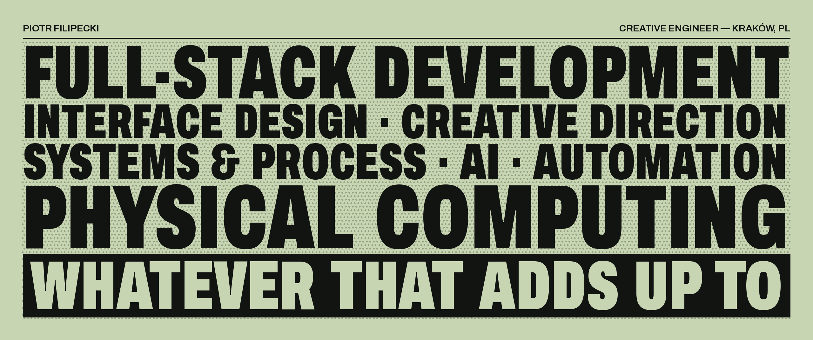

I take a vague idea and hand back a thing that works: designed, built, wired up, shipped.
Fourteen years, one person, from the first sketch to the server it runs on.

Independent creative engineer in Kraków, Poland, with an agency background in campaigns for brands in FMCG, finance and tech. These days: websites with a custom CMS the team actually runs, e-commerce, product configurators, mobile apps, internal tools, automations and AI integrations — and the systems that wire them together.

### Selected work

- **[September Art Agency](https://piotrfilipecki.com/work/september-art-agency)** — creative agency website + custom CMS
- **[EMWU Hats](https://piotrfilipecki.com/work/emwu-hats)** — headless Shopify store on Next.js
- **[FRIENDZ × GOAT](https://piotrfilipecki.com/work/friendz-goat)** — music campaign platform
- **[Prozak 2.0](https://piotrfilipecki.com/work/prozak-20)** — nightlife brand, web
- **[Amadeusz Design](https://piotrfilipecki.com/work/amadeusz-design)** — studio identity, web

All case studies → **[piotrfilipecki.com/work](https://piotrfilipecki.com/work)**

### In the lab

Browser experiments where math and physics turn into interaction: lightpainting with a phone as the brush, editing text with hand gestures and an LLM, a 70s TV dance battle in R3F + GLSL. Repos open here as they're ready.

### Tools

### Contact

Open to freelance projects and contract or full-time remote roles.
**[contact@piotrfilipecki.com](mailto:contact@piotrfilipecki.com)** · [LinkedIn](https://linkedin.com/in/piotr-filipecki) · [Instagram](https://instagram.com/piotrfilipecki) · [piotrfilipecki.com](https://piotrfilipecki.com)
